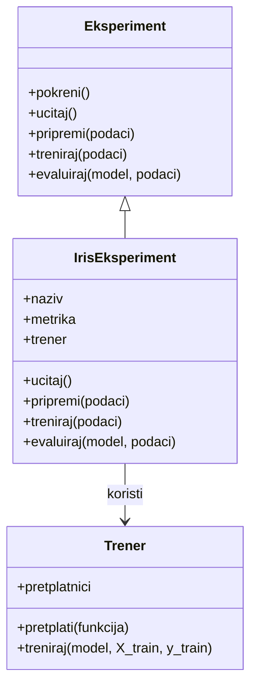

# Mini projekat 2 - ML eksperimenti

U ovom zadatku je napraviljen jednostavan program za treniranje i provjeru ML modela na Iris skupu podataka. Radjen je u Google Colabu, tako da je svaki dio odvojen u svoju ćeliju.

## Pokretanje

Otvoriti `Domaci_3.ipynb` u Google Colabu i pokrenuti ćelije redom. Program isprobava kNN i stablo odlučivanja, ispisuje događaje tokom treniranja, vrijeme izvršavanja i tačnost na test podacima.

Za pokretanje testova lokalno potrebni su `scikit-learn` i `pytest`. Iz foldera u kojem su fajlovi pokrenuti:

```bash
pip install scikit-learn pytest
python -m pytest -q test_projekat.py
```

`test_projekat.py` učitava programski kod iz notebooka i provjerava ga kroz sedam `pytest` testova. 

## Projektni šabloni

- **Factory** - rječnik `MODELI` i funkcija `kreiraj_model()` biraju model.
- **Strategy** - `METRIKE` i `izracunaj_metriku()` biraju MAE, MSE ili accuracy.
- **Observer** - `Trener` obavještava pretplatnike na početku i kraju treniranja.
- **Template Method** - `Eksperiment` određuje redosljed učitavanja, pripreme, treniranja i evaluacije.
- **Decorator** - `mjeri_vrijeme()` mjeri trajanje eksperimenta.


## Dijagram klasa



Factory i Strategy su funkcije i rječnici, pa nijesu posebne klase na dijagramu.

## Korišćenje AI alata

-ChatGPT je korišćen za objašnjenje projektnih šablona kao i pomaganju u razumijevanju sintaxe, povezivanje djelova koda, eventualnu vizualizaciju i koriscenje mirmaid sintaxe.
-Bio je koristan u razumijevanju Observer sablona i upozoravanje na greske prilikom evidentiranja pracenja treninga.
-Pomogao je u trazenju Iris dataseta iz sklearn.datasets.

